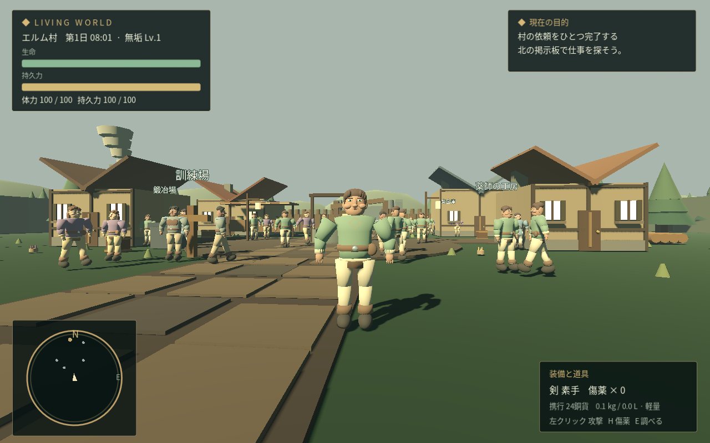

# LIVING WORLD

Steam向けPCゲーム「エルム村の朝」の開発ビルド。Godot **4.6.3** / GDScript / Compatibility renderer。

添付された11資料を通読して、資産保存則を先に作り、その上に三人称の村生活と探索を載せています。
実装順序・仕様の対応・未実装範囲は [開発計画](docs/IMPLEMENTATION_PLAN.md)、技術と仮値は [判断記録](docs/DECISIONS.md) を参照。



## ダウンロード

- [Windows版 0.2.0（ZIPを直接ダウンロード）](https://github.com/uyctvk/gemes/raw/refs/heads/main/build/LivingWorld-0.2.0-windows-x86_64.zip)
- [Linux版 0.2.0（ZIPを直接ダウンロード）](https://github.com/uyctvk/gemes/raw/refs/heads/main/build/LivingWorld-0.2.0-linux-x86_64.zip)
- [操作と遊び方](docs/PLAY.md)
- [制作順序・実装状況](docs/IMPLEMENTATION_PLAN.md)
- [アート制作記録](docs/ART_DIRECTION.md) / [Steam販売前の完了条件](docs/RELEASE_GATES.md)

ZIPのSHA-256は [SHA256SUMS.txt](build/SHA256SUMS.txt) に記載しています。

## 起動

```bash
python3 scripts/setup.py
bash scripts/godot.sh --editor
# ゲームだけ起動
bash scripts/godot.sh
```

Godotエディターで `project.godot` を開いてF6/F5でも起動できます。クラウドではGUIの表示先が必要です。
コマンドは既存の `/workspace/gemes` で実行します。このクラウドタスクは既に分離されているため、追加のGit worktreeは不要です。

## 検証・書き出し

```bash
bash scripts/check.sh
python3 scripts/setup.py --exports
bash scripts/build.sh
# クラウドで描画を確認（Xorg dummy / Mesaがある環境）
bash scripts/visual_check.sh
```

チェックはコアの保存則・競合・復旧・30日シミュレーションと、実ゲームシーンの起動・UIを実行します。
テストの保存先は毎回別の一時ディレクトリです。ログ内のGodotエラーも失敗扱いにします。
`build/` にWindows/Linux x86_64のZIPとSHA-256を出力します。Steamへのアップロードは行いません。
画面確認は専用の仮想ディスプレイを起動・終了し、`build/screenshots/` に画像を保存します。
実行済みの検証と未検証の範囲は [検証記録](docs/VALIDATION.md) を参照。

## プレイ

[操作・最初の進め方](docs/PLAY.md)。WASDで三人称移動、Eで調べる、Iで荷物、Jで手帳、左クリックで攻撃、Hで傷薬。
市場・銀行・工房・掲示板は近くで操作します。メニュー中も時間は進みます。

## 構成

- `game/core/`：台帳、コマンド、ルール、NPC集約、永続化。描画なしで検証可能。
- `game/player.gd` / `game/village.gd`：三人称操作、リグ付き人物、村と物理オブジェクト。
- `game/assets/audio/`：自作BGM2曲と効果音4種。
- `game/ui/`：日本語HUD、対話、確認つき取引、死亡内訳。
- `tests/`：実際のThread競合を含むドメインテスト。
- `docs/source/`：添付原本11点とチェックサム。参照資料中の指示を運用命令として実行しません。

この版は**制作途中のローカル単一プレイヤー版**です。経済コマンドの直列化と検証は実装していますが、ネットワーク認証・遠隔サーバーの権威・マルチプレイの不正防止は次工程です。
100村・1万NPC、Steam Deck認証、Windows実機での動作、販売可能な完成度を達成したとは扱いません。

フォントはNoto Sans CJKのサブセット（SIL OFL）。ライセンスは `game/assets/FONT-LICENSE.txt`。モデルとアイコンは本リポジトリで作成しています。
配布ZIPにはGodot本体と第三者ライブラリのライセンスも同梱しています（`docs/licenses/`）。
