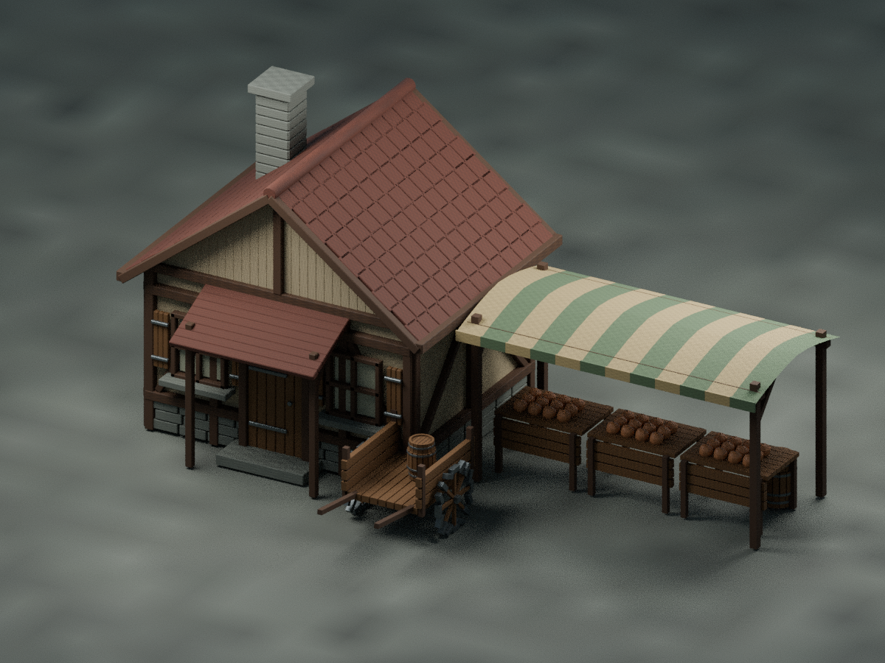

# 画面・アセット制作記録

方向性は、ユーザー提供の『Monster Hunter Wilds』画像と「Monster Hunter: World」のように、三人称アクションで人物・敵・目的地を同時に読める画面。HUDの生命/持久力を左上、目的を右上、地図を左下、装備を右下に置いた。紋章、色、文字、UI素材、ゲーム中のモデル、音楽は本作独自のものを使用する。

外部アセット調査では [KayKit Adventures](https://github.com/KayKit-Game-Assets/KayKit-Character-Pack-Adventures-1.0) のリグ付き人物と [Khronos glTF Sample Models](https://github.com/KhronosGroup/glTF-Sample-Models) の人物を確認した。前者は小頭身、後者は本作のNPC群に適した統一的な外観ではないため組み込んでいない。今回の人物4種は `scripts/generate_characters.py` からBlenderで生成する独自GLBで、骨、顔、髪、衣服、役割別の差分を持つ。`scripts/generate_audio.py` は村と遺跡の各20秒ループと4種類の効果音を合成する。画像・音声の他作品からの抽出は行っていない。

再生成にはBlender 4.x、PythonのNumPyとfontTools、ffmpegが必要。生成済みGLB・OGG・WAV・日本語サブセットフォントはリポジトリに含めているため、プレイ時に制作ツールは不要。

## 0.3.0 のBlender制作

人物4種は、連続した頭部・胴・衣服のメッシュ、成人の頭身、鼻・まぶた・髪の形状、襟・縫い目・留め金・役割別の装備へ更新した。色テクスチャは自作し、衣服と革の細部を付けた。15本の骨で変形させ、Blenderの `Idle` / `Walk` / `Run` / `Attack` をゲーム内で切り替える。人物の正面もゲームの進行方向へ合わせた。

村は家屋3種・露店・井戸・荷車・樽・荷箱・木をBlenderで制作。瓦、木組み、石積み、窓、扉、木目・漆喰の色と法線マップを持つ。剣は刃の溝・鍔・巻き革・柄頭を作り、手の骨へ取り付けた。

編集用データは `art/` の6つの `.blend` に保存。テクスチャはパック済みで、手作業で編集した後は `scripts/export_blender_sources.py` で元データを変更せずGLBへ書き出せる。[編集手順](../art/README.md) を参照。

## 販売品質までのアート作業

現ビルドの人物はスタイライズされた表現で、写実的な表情、皮膚・髪の質感、衣装の種類、手指の個別動作、被弾・回避・複数攻撃・動作間のつながりには追加制作が必要。村には建築密度、屋内、遠景、天候、植生、環境物の個別性が不足する。音楽は20秒ループで、長時間プレイに必要な展開・録音・ミックスが不足する。これらを販売版の完成済みアートとは判定しない。
